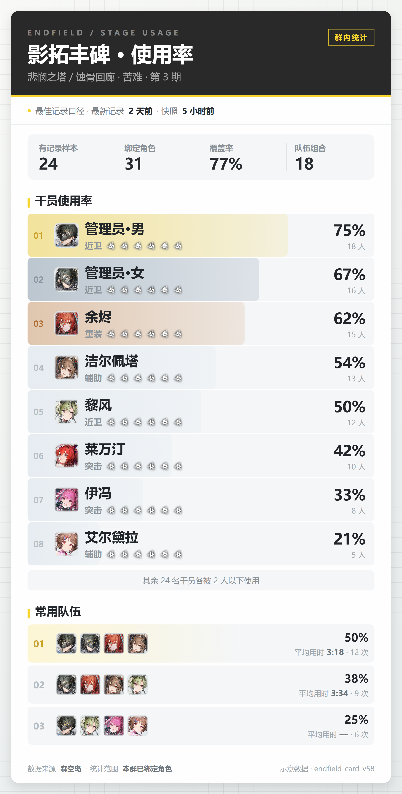
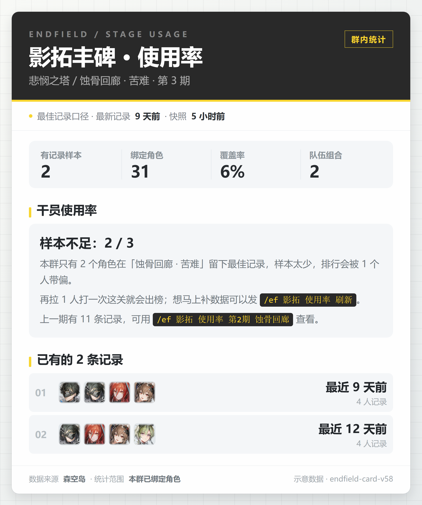
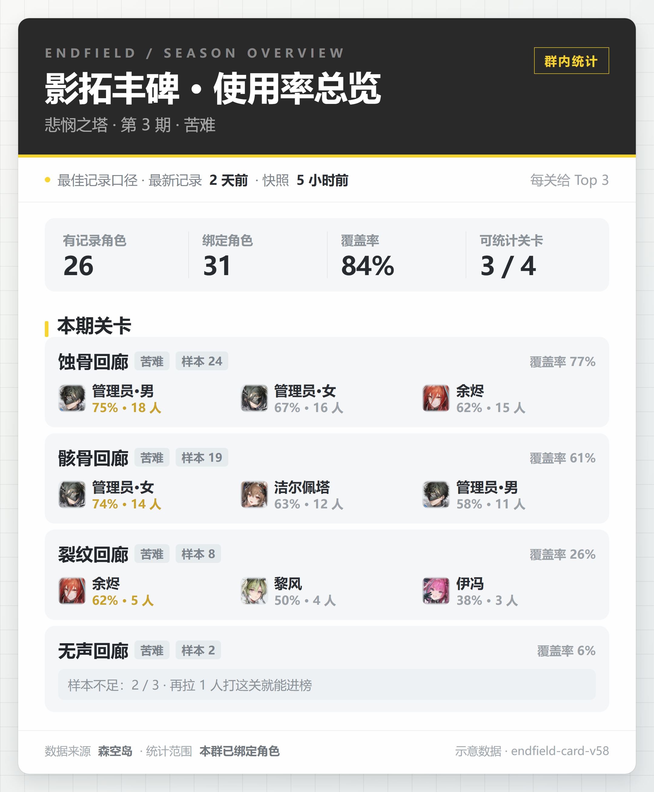

# 终末地关卡成员使用率 · 卡片前端设计

状态：设计稿 v2（示意数据渲染，未接入真实聚合）　·　创建 2026-10-23
口径来源：[`endfield_usage_stats_design.md`](endfield_usage_stats_design.md)
示意图：[单关卡卡](images/endfield-usage-stats/usage-single-card.png) · [样本不足卡](images/endfield-usage-stats/usage-insufficient-card.png) · [当期概览卡](images/endfield-usage-stats/usage-overview-card.png)
手机尺寸预览（375px 宽，判断可读性用）：`docs/images/endfield-usage-stats/preview-375/`

## 1. 为什么重做

v1 直接套了持有率统计的"报表风"：1500px 宽、满屏 1px 硬边框、字重 950、一屏塞 15 行。三个问题：

- **移动端不可读**。1500 → 375 是 4 倍缩放，15px 干员名缩到 3.7px，等于没有。
- **风格错位**。硬边框 + 超粗字重像内部报表，不像这个机器人自己出的卡。
- **信息密度选错**。排行榜和队伍组合挤在同一张长图里，谁都读不完。

## 2. 新版基调

**沿用已经上线的蚀刻章统计卡语言**（`docs/images/endfield-medals/stats.png`）：深色头部 + 英文小标 + 金色细线 + 浅灰圆角面板 + 大数字。全卡只留三段结构：**我在看什么 → 有多少样本 → 谁在上场**。

- 画布 1080px 竖版，最小正文 24px。
- **卡片浮在网格底上**：外圈 30px 留白露出插件统一的 40px 网格底（`rgba(29,34,39,.065)` + `#f8f9f6→#e6eaeb` 渐变，与账号卡、持有率卡同一套），卡片本体 1020px 宽、圆角 18px、外投影。这样它和群里其他终末地卡放在一起是同一系列。
- 不再用边框分隔，改用底色面板（`#f4f6f8`）+ 圆角 12–16px + 8px 间隙。
- 强调色克制：金色 `#f8d52e` 给头部色条与徽标；排行前三名用金 / 银 / 铜三色浅底区分，其余一律中性灰。
- 排行榜用**整行进度条**（浅底 + 填充），不做独立条形列，省一列宽度留给名字。

## 2.1 扁平规范与前三名配色

整张卡是扁平的：**不加任何内阴影、斜面、高光**，层次只靠"网格底 → 白卡 → 浅灰面板/行"三层底色区分，阴影只用在外圈卡片本身（`0 12px 30px rgba(23,27,31,.13)`）。

- 头部：实底 `#292929`，底部色条是**纯色** `#f8d52e`（5px，不做渐变）。
- 排行行：整行浅灰底 `#f4f6f8` 作轨道，填充用极浅的中性渐变（`#e6ecf1→#eff3f6`），不加深、不加投影。
- 前三名只换填充色调与名次数字颜色：

| 名次 | 填充 | 名次数字 |
| --- | --- | --- |
| 01 | 金 `rgba(240,200,28,.42)→.12` | `#c9a227` |
| 02 | 银 `rgba(178,190,201,.85)→.35` | `#8b96a1` |
| 03 | 铜 `rgba(196,131,72,.42)→.14` | `#b06f33` |
| 04+ | 中性 `#e6ecf1→#eff3f6` | `#b6bdc2` |

非前三名的填充要压到比银更淡，否则银牌读不出"特殊"。

- 队伍组合第一名沿用金色浅底（`rgba(248,213,46,.2)` 渐隐到无色），与前三名同属"奖励"语汇。
- 头像、徽标、提示块一律平铺，不描边、不落影。
- **文案只留必要信息**：区块标题右侧不再挂"使用人数 ÷ 有记录样本""按成员集合去重"这类口径说明；样本格只留标题+数字；口径统一写在设计文档和维护文档里，卡片内不复述。
- 分隔符统一用半角空格夹 `·`（` · `），不用全角空格，否则视觉间距过大。
- 第二行 = 职业文字（23px / 字重 600 / `#8f979d`）+ 星级，两者之间只用间距，不加分隔符。
- 星级用官方素材 `assets/image/endfield/rarity-star.png` 重复 N 次（32×32、间距 4px、`drop-shadow(0 1px 0 rgba(255,255,255,.7)) drop-shadow(0 1px 2px rgba(23,27,31,.28))`），与职业文字同排居中；不要写 `6★`，也不要用 ★ 字形代替。
- 职业图标素材在 AKEData 里存在（`sprites/charprofessionicon/icon_profession_{0,2,4,5,7,8}.png`，纯白蒙版），但实测在浅色行上又细又淡、辨识度不如文字，**不采用**。

## 3. 可读性换算

QQ 里图片按宽度铺满，1080px 画布在 375px 屏上缩放 0.347：

| 元素 | 画布字号 | 手机上 | 结论 |
| --- | --- | --- | --- |
| 卡标题 | 56 | 19.4 | 够大 |
| 干员名 | 36 | 12.5 | 清晰 |
| 百分比 | 41 | 14.2 | 主信息，最醒目 |
| 样本数字 | 42 | 14.6 | 清晰 |
| 专业/星级、次数 | 23 | 8 | 职业文字 23px / 字重 600；星级是 32px 图标，缩到手机上约 11px |
| 说明段落 | 24 | 8.3 | 正文底线，不再往下走 |

规则：**任何正文不小于 20px（≈7px 手机）**；低于这个数只能当装饰（英文小标、页脚），不能承载信息。

## 4. 卡片结构

### 4.1 单关卡卡



| 区块 | 高度 | 内容 |
| --- | --- | --- |
| 外框 | 30 | 网格底留白；卡片自身圆角 18px、投影 `0 12px 30px rgba(23,27,31,.13)` |
| 头部 | ~250 | 深色 `#292929`；英文小标 `ENDFIELD / STAGE USAGE`（20px，字距 .34em）；标题 56px；副标题 26px = 主题 / 关卡 · 难度 · 期次；右上角金框 `群内统计`；底部 5px **纯色**金条 |
| 时效 | 60 | 白底，金色圆点 + `最佳记录口径 · 最新记录 2 天前 · 快照 5 小时前`。**不带任何补充说明**，口径解释只放设计文档 |
| 样本 | 110 | 浅灰圆角面板，4 格竖线分隔：只需标题 + 数字，**不放小字注释**（"本关有最佳记录"这类全部删掉） |
| 排行 | 8 × 100 | 整行进度条；名次、头像 66px、名字 36px + 第二行「职业 + 星级图标 ×N」（无分隔符）、右侧百分比 41px + 人次 |
| 长尾 | 46 | 灰底一行 `其余 24 名干员各被 2 人以下使用` |
| 队伍 | 3 × 92 | 名次、4 个头像 56px、右侧 `50%` + `平均用时 3:18 · 12 次`；不显示最近记录时间（卡片时效条已经给了全局最新记录）；第一名金色浅底。实测有队伍必有 `passTs`，不需要"用时缺失"降级 |
| 页脚 | 60 | 数据来源 / 统计范围 / 渲染版本 |

**排行只放 8 名**，超出合并一行。理由：8 行在手机上已经是一屏半，15 行没人会看到底；完整榜单属于后续 `All` 档位或单独命令。

### 4.2 样本不足卡



同头部、时效、样本区，把排行整段换成：

- **状态面板**：圆角灰底，标题 `样本不足：2 / 3`（33px），三行正文（24px）：为什么不出率、差多少、怎么补（命令用黑底金字 `code`）、上一期有多少条。
- **已有记录**：把现有队伍按行摊开，右侧只写时间与人数，**不出现百分比**——有 1 条记录不等于 100% 使用率。

0 个样本时省掉记录块，状态面板文案降级为"本群还没有人在这关留下记录"。

### 4.3 当期概览卡



- 头部小标换 `ENDFIELD / SEASON OVERVIEW`，标题 `影拓丰碑 · 使用率总览`，副标题带期次与难度。
- 样本区第 1、4 格换口径：`有记录角色`、`可统计关卡 3 / 4`。
- 每关一块灰底面板：第一行 = 关卡名 30px + 难度 chip + 样本 chip + 右对齐覆盖率；第二行 3 个 Top 成员（头像 46px + 名字 23px + 金色百分比）。
- 样本不足的关卡**保留面板**，第二行换成一行灰底提示，不整块删掉——缺哪关本身是信息。

## 5. 颜色与字体

| 用途 | 值 |
| --- | --- |
| 头部底色 | `#292929` |
| 强调金（前三、口径点、命令文字） | `#f8d52e`；深金 `#c9a227` 用于名次数字 |
| 页面底色 | `#fefefe` |
| 面板底色 | `#f4f6f8`；次级提示 `#eef1f3` |
| 正文 | `#2b2f33`；次级 `#7c848b`；弱 `#a2a9ae` |
| 分隔线 | `#eceff1` |
| 外圈网格底 | 40px 格距、线 `rgba(29,34,39,.065)`、底 `linear-gradient(135deg,#f8f9f6,#e6eaeb)`（与插件其他卡一致） |

字体：`Microsoft YaHei / PingFang SC / HarmonyOS Sans SC`。字重只用 500 / 600 / 700 / 800，取消 v1 的 950。

## 6. 状态矩阵

| 情况 | 表现 |
| --- | --- |
| 群内无绑定 | 头部 + 灰色面板"本群还没有绑定角色"，附 `/ef 绑定` 指引 |
| 有绑定、0 记录 | 样本区全 0 + 状态面板"还没有人在这关留下记录" |
| 1–2 记录 | 样本不足卡 |
| ≥ 3 记录 | 单关卡卡；超过 8 名的合并一行 |
| 记录超 30 天 | 正常出卡，时效条"最新记录"改为金色提示陈旧 |
| 头像缺失 / 目录外干员 | 首字兜底方块（`#e7ebee` 底），不印 hex id |
| 高度超限 | 概览卡每页 5 关拆页；单关卡卡 Top8 → Top6 |

## 7. 落进代码

新增 `plugins/endfield/usage/draw.py`：

```text
prepare_usage_stage_html(report)      -> PreparedCardHtml   # 宽 1080
render_usage_stage_html(report, icon_map=None)               # 离线预览 / 测试
draw_usage_stage(report)              -> tuple[bytes, ...]
prepare_usage_overview_html(report)   -> PreparedCardHtml
draw_usage_overview(report)           -> tuple[bytes, ...]
```

- 截图选 `.page`（含网格留白的那层），画布 1080，生产缩放 1.25 → 输出 1350px 宽；卡片本体 1020px 由 `.page` 的 30px padding 决定。
- `OVERFLOW_SELECTORS = (".row", ".team", ".stage", ".sample", ".note")`，被裁切时抛高度错误而不是静默切行。
- 素材同持有率管线：`note_remote_assets(..., namespace=REMOTE_ASSET_NAMESPACE)` + `_prepare_assets(inline=False)`。
- 头像 `…/sprites/charremoteicon/icon_{charId}.png`；缺图首字兜底。

## 8. 验收

1. 三张卡按 375px 宽度出预览，正文不小于 7px 且不需要横滑（`preview-375/` 已留样）。
2. 构造 0 / 1 / 2 / 3 个样本，确认 2 → 3 处形态翻转。
3. 构造 12 名干员命中，确认第 9 名被合并进"其余 N 名"。
4. 概览卡塞 12 关，确认按 5 关/页拆页，且每页头部页脚齐全。
5. 构造缺头像干员与目录外干员，确认首字兜底、不出现 hex。
6. `record_ts=0` 时时效条写"时间未知"，不出现 1970。

## 9. 不做

- 不做环形图：使用率是单维比例，环形会诱导"占比合计 100%"的错误直觉。
- 不做趋势折线、干员矩阵、跨期对比——属于 P2 `All` 档位。
- 不在卡里放二维码或深链。
